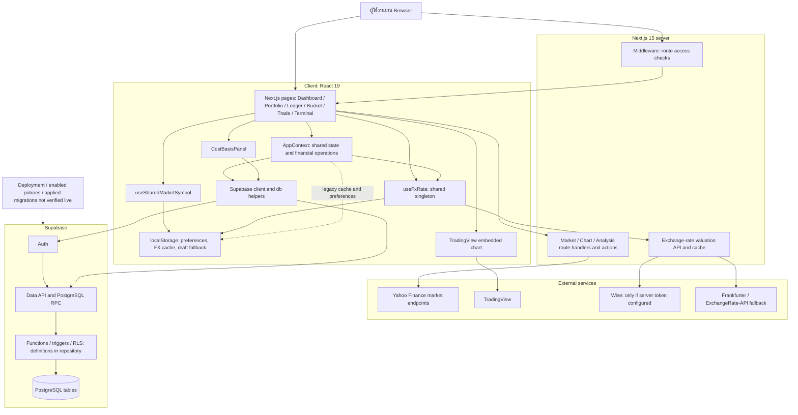
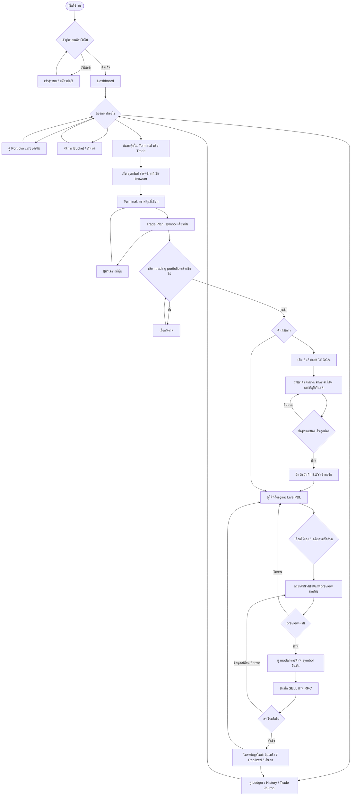
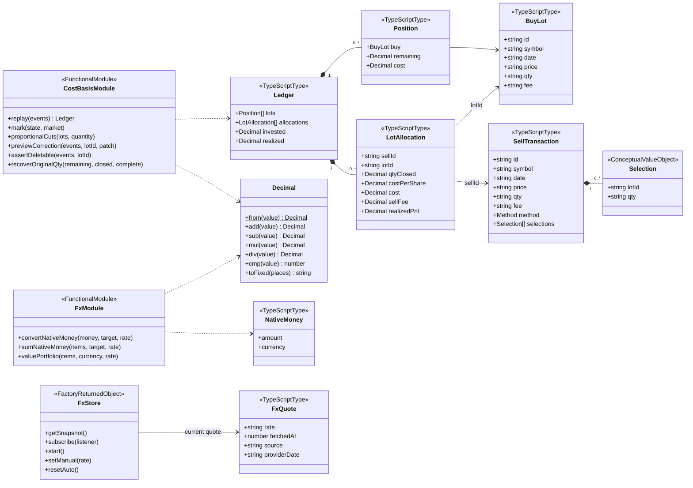
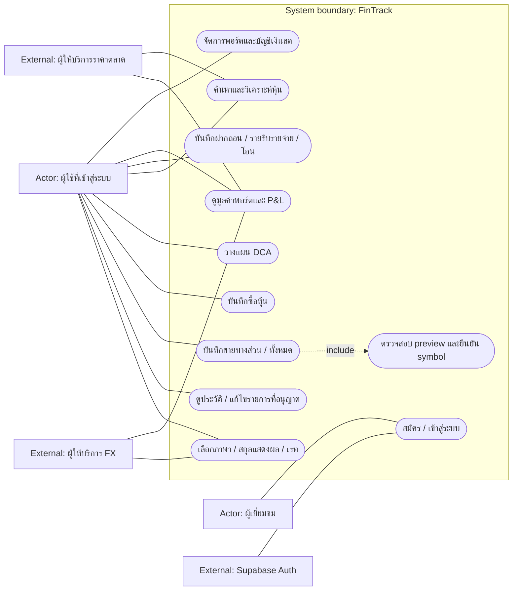
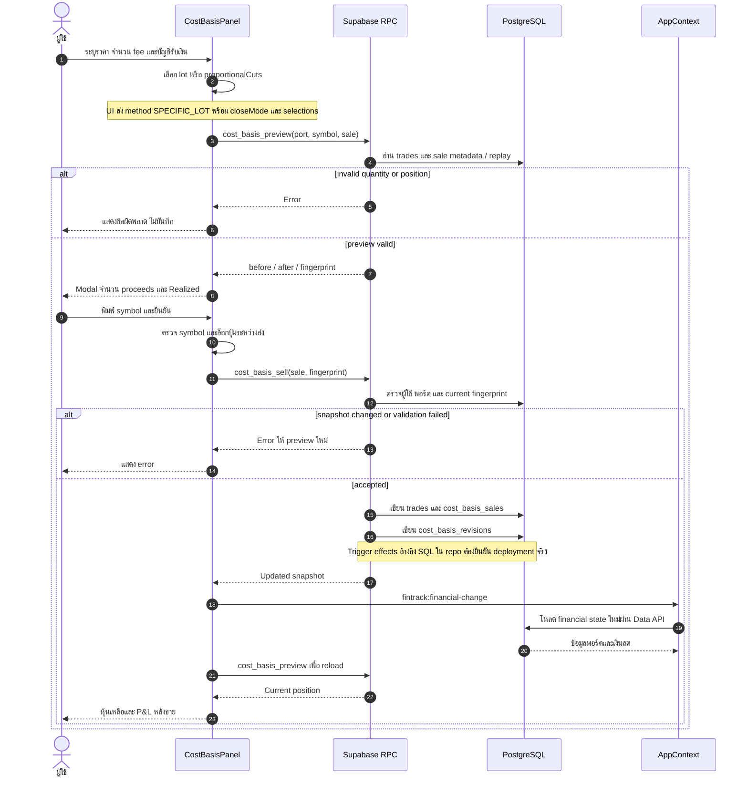
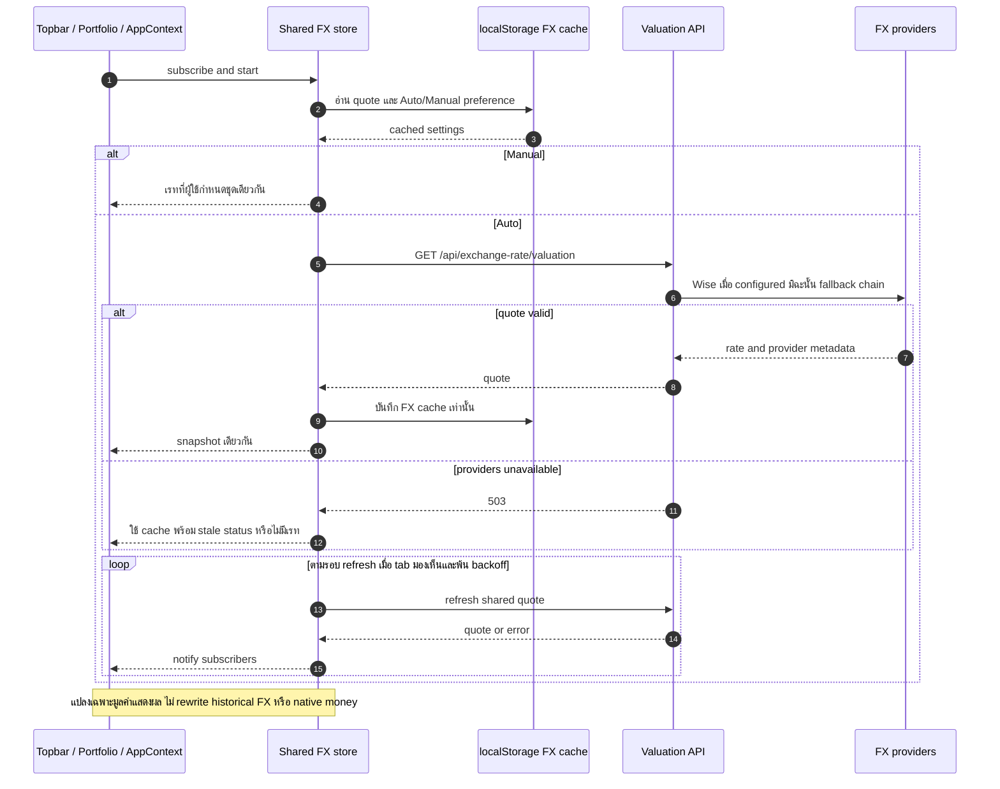
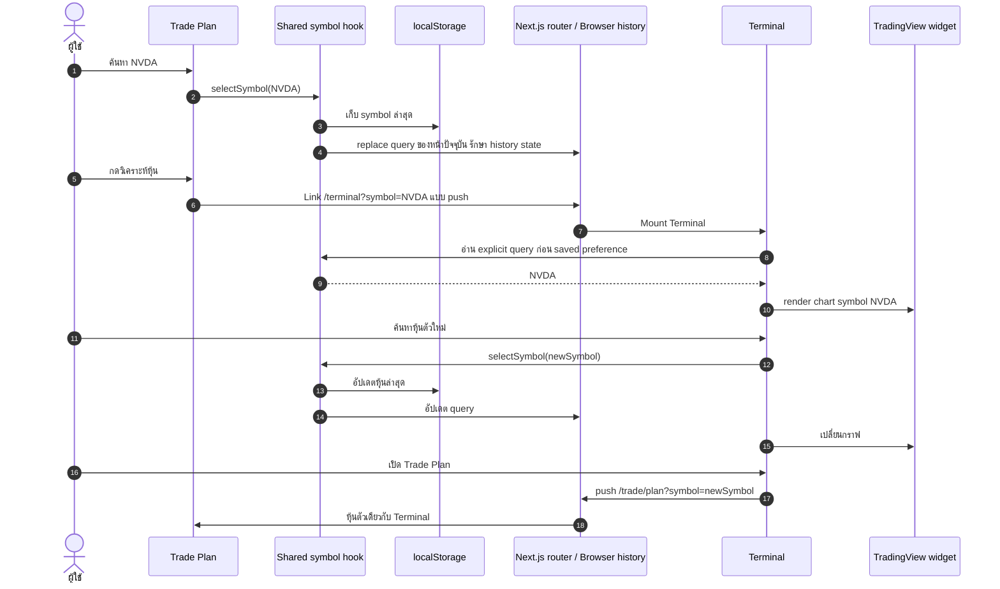

# FinTrack — ชุดไดอะแกรมและคำอธิบาย

จัดทำ 13 ตุลาคม 2026 จาก working tree และ schema ที่ผู้ใช้แนบ ไม่ใช่ snapshot จาก production

## สถานะการส่งมอบ

อัปเดตล่าสุด: [แนวทางแก้รายงานและเป้าหมาย Web / PC / Mobile](report-multiplatform-revisions.md), [ข้อความทดแทนในเล่ม](thesis-replacement-text.md) และ [Target Architecture](01b-system-architecture-target.mmd) แยกระบบปัจจุบันกับแผนพัฒนาอย่างชัดเจน

ทำได้ครบ 6 ประเภท: Architecture, User Flow, Class, ER, Use Case, Sequence โดย Sequence แยก 3 สถานการณ์ รวมเป็น 8 ไฟล์ .mmd

- ใช้ไฟล์ .mmd กับ Mermaid renderer หรือ copy fenced block ด้านล่าง
- schema ทุกคอลัมน์อยู่ใน [database-dictionary.md](database-dictionary.md)
- prompt รายประเภทและ prompt ขอข้อมูลที่ยังขาดอยู่ใน [prompts.md](prompts.md)
- ไม่มีการแก้ application code, schema, migration, Supabase หรือ localStorage ในงานเอกสารนี้
- หลักฐานระดับ A: schema ที่ผู้ใช้แนบ; B: source code ใน working tree; C: conceptual grouping ที่ระบุไว้; ยังไม่ได้รับรอง production deployment

## 1. System Architecture Diagram

ตอบคำถาม “ระบบประกอบด้วยอะไร และแต่ละส่วนสื่อสารกันอย่างไร” เป็นภาพระดับ logical architecture ไม่ใช่ผังเครื่อง server จริง

- Client: Next.js pages และ React components; AppContext รวม state และการทำรายการ, Supabase client ติดต่อ Auth/Data API/RPC โดยตรงได้ ไม่ใช่ทุก request ต้องผ่าน Next.js API
- Server: Route handlers / server actions สำหรับราคา กราฟ และ FX; middleware ควบคุมการเข้าถึงหน้า
- External: TradingView เป็นกราฟฝังใน browser; Yahoo Finance เป็นแหล่งข้อมูลที่พบใน market actions; Wise ใช้เมื่อมี server token และมี provider สำรอง
- Storage: PostgreSQL เก็บรายการหลัก; localStorage เก็บ preference, FX cache และ legacy/draft fallback บางส่วน ไม่ใช่แหล่งหลักเดียวของระบบ
- เส้นประหมายถึงความสัมพันธ์รอง/ข้อจำกัดของหลักฐาน ไม่ใช่ firewall หรือ network protocol
- ไม่ใส่ broker execution API: ไม่พบหลักฐานว่าแอปส่งคำสั่งซื้อขายเงินจริงไป Dime/Webull
- การติดตั้งบน Vercel เป็นบริบทจากผู้ใช้ แต่ยังไม่ได้ตรวจ deployment configuration, region, HA, replicas หรือ production topology จึงไม่วาดเป็นข้อเท็จจริงด้าน infrastructure

ไฟล์: [01-system-architecture.mmd](01-system-architecture.mmd)

## 2. User Flow Diagram

ตอบคำถาม “ผู้ใช้ทำอะไรต่อจากอะไร” ใช้มุมมองหน้าจอและจุดตัดสินใจ ไม่ใช่ลำดับ database calls

เส้นทางหลัก: เข้าสู่ระบบ → Dashboard → เลือกพอร์ต/ค้นหาหุ้น → วิเคราะห์ใน Terminal → วางไม้ DCA → บันทึกซื้อ → ตรวจสถานะ → preview การขาย → ยืนยัน → โหลดผลใหม่

- Draft ยังไม่ใช่หุ้นที่ซื้อแล้ว
- หน้าที่ต้องบันทึกการลงทุนต้องเลือก trading portfolio; cash_management มีหน้าที่สำหรับเงินสด/Bucket
- ข้อมูลผิดหรือยอดขายเกินต้องกลับไปแก้ ไม่ข้ามไปบันทึก
- “เฉลี่ย” ใน flow นี้คือแบ่งจำนวนขายตามสัดส่วนหุ้นที่เหลือ ไม่ใช่การเลือก AVERAGE tax accounting method ต่อ symbol
- ยังไม่จำลองทุก validation ของทุกฟอร์ม เช่น สมัครสมาชิก/2FA เพราะไม่ได้ตรวจครบทุกเงื่อนไข

ไฟล์: [02-user-flow.mmd](02-user-flow.mmd)

## 3. Class Diagram / Domain Model

ตอบคำถาม “ข้อมูลใน business logic มีรูปร่างอย่างไร และฟังก์ชันใดรับผิดชอบ”

React ใช้ function components และ hooks เป็นหลัก จึงไม่แสร้งว่า AppContext หรือหน้าจอทั้งหมดเป็น OOP classes:
- TypeScriptType = type ที่มีในโค้ดจริง
- FunctionalModule = รวม free functions เพื่ออธิบายความรับผิดชอบ ไม่ใช่ class declaration จริง
- FactoryReturnedObject = object ที่ createFxStore คืนค่า
- ConceptualValueObject = ตั้งชื่อให้ inline structure เพื่อให้อ่าน diagram ได้ ไม่ได้อ้างว่ามี named class นี้ใน repo
- Decimal เป็น class จริงใน cost-basis-ledger.ts ใช้เลข rational/BigInt เพื่อคำนวณแม่นยำ; ค่าที่ส่งผ่าน persistence boundary เป็น decimal string
- BuyLot.qty คือจำนวนซื้อเดิม; Position.remaining เป็น projection จาก replay
- LotAllocation เป็นผลลัพธ์ใน domain model ไม่มีตาราง public.lot_allocations ใน schema ที่แนบ
- Ledger รวม lots, allocations, invested, realized; mark คำนวณ unrealized/total
- NativeMoney แยก amount กับ currency; FX conversion เป็น presentation helper ไม่ใช่การแก้ยอดต้นฉบับ
- ลูกศร dependency ไม่ได้แปลว่าเป็น FK ในฐานข้อมูล

ไฟล์: [03-class-domain.mmd](03-class-domain.mmd)

## 4. ER Diagram / Database Schema

ตอบคำถาม “ตารางไหนเชื่อมกับตารางไหนผ่านคีย์อะไร” ภาพนี้สร้างจาก CREATE TABLE ที่คุณแนบทั้งหมด ไม่รัน SQL

มี 18 ตาราง public, 221 คอลัมน์, 41 foreign keys และ auth.users แบบ external stub เฉพาะ id

วิธีอ่าน:
- PK = primary key; FK = foreign key; cost_basis_methods มี composite PK (user_id, portfolio_id, symbol)
- required = NOT NULL หรือเป็นส่วนหนึ่งของ PK; nullable = ไม่ได้บังคับ NOT NULL
- || = ต้องมีหนึ่งรายการฝั่งนั้น; |o/o| = ศูนย์หรือหนึ่ง; o{ = ศูนย์หรือหลาย
- ตารางลูกที่ portfolio_id nullable จึงมีพอร์ตได้ 0 หรือ 1 จาก schema ไม่ควรวาดว่าต้องมีเสมอ
- เส้นทึบใช้เมื่อ FK เป็นส่วนของ PK และเส้นประใช้กับ non-identifying relationships; จุดสำคัญคือ cardinality และชื่อ FK อ้างอิงจริง
- timestamp with time zone ย่อเป็น timestamptz, character varying ย่อเป็น varchar, ARRAY ใช้ array ในภาพ; ดู declaration เดิมใน database-dictionary.md
- ภาพใหญ่มาก เหมาะใช้ SVG ที่ซูมได้ หรือแบ่งเป็นกลุ่มเมื่อนำลงรายงาน
- Schema ไม่มีข้อมูล ON DELETE, indexes เพิ่มเติม, RLS policy, trigger, view หรือ deployed function definitions จึงไม่อ้างว่าตรวจสิ่งเหล่านี้แล้ว

กลุ่มตาราง:
1. Identity / scope: profiles, portfolios
2. Investment: assets, trades, allocations, brokerage_accounts, brokerage_cash_entries
3. Cash management: money_buckets, cash_activities, bucket_activities, user_categories
4. Planning: dca_drafts, trade_journal
5. Audit / reporting: history_events, portfolio_snapshots, cost_basis_revisions
6. Cost basis metadata: cost_basis_methods, cost_basis_sales

ข้อควรระวัง:
- allocations คือการจัดสรรพอร์ต ไม่ใช่ LotAllocation
- history_events.portfolio_id / source_record_id / related_bucket_id ไม่มี FK ใน schema นี้ ห้ามเติมเส้น FK เอง
- assets ไม่มี currency ใน schema ที่แนบ; ห้ามสรุปสกุลของ current_price/avg_purchase_price จาก symbol
- portfolio_snapshots.total_value และ allocations.value ไม่มี denomination ชัดเจน
- brokerage_accounts มี USD/THB/JPY/EUR ใน constraint แต่ shared FX ที่เพิ่งปรับรองรับ USD/THB ไม่ได้ยืนยัน live JPY/EUR
- DEFAULT USD ไม่ยืนยันว่ายอด legacy ทุกแถวเป็น USD จริง
- money_buckets.currency required แต่ trade currency และ activity currency บางตารางยัง nullable

ไฟล์: [04-er-full.mmd](04-er-full.mmd)

```mermaid
erDiagram
    auth_users {
        uuid id PK
    }
    profiles {
        uuid id PK, FK "required"
        text email "required"
        text full_name "nullable"
        text avatar_url "nullable"
        text language "nullable"
        text currency "nullable"
        boolean email_verified "nullable"
        text account_status "nullable"
        inet registration_ip "nullable"
        text device_fingerprint "nullable"
        text user_agent "nullable"
        timestamptz last_login_at "nullable"
        timestamptz created_at "nullable"
        timestamptz updated_at "nullable"
        text terminal_symbol "nullable"
        text terminal_interval "nullable"
    }
    assets {
        uuid id PK "required"
        uuid user_id FK "required"
        text name "required"
        text symbol "required"
        text asset_type "nullable"
        numeric value_usd "required"
        numeric quantity "nullable"
        numeric avg_purchase_price "nullable"
        numeric current_price "nullable"
        numeric change_24h "nullable"
        numeric change_percentage "nullable"
        numeric allocation_target "nullable"
        numeric allocation_current "nullable"
        text sector "nullable"
        text country "nullable"
        text notes "nullable"
        boolean is_active "nullable"
        timestamptz created_at "nullable"
        timestamptz updated_at "nullable"
        boolean is_favorite "nullable"
        integer sort_order "nullable"
        text allocation "nullable"
        uuid portfolio_id FK "nullable"
        uuid brokerage_account_id FK "nullable"
    }
    trades {
        uuid id PK "required"
        uuid user_id FK "required"
        uuid asset_id FK "nullable"
        text asset_name "required"
        text symbol "required"
        text type "required"
        numeric amount_usd "required"
        numeric quantity "required"
        numeric price_at_execution "required"
        text currency "nullable"
        numeric exchange_rate_at_time "nullable"
        numeric fees "nullable"
        numeric taxes "nullable"
        numeric total_cost "nullable"
        numeric profit_loss "nullable"
        numeric profit_loss_percentage "nullable"
        timestamptz execution_date "nullable"
        timestamptz settlement_date "nullable"
        text status "nullable"
        text notes "nullable"
        array tags "nullable"
        timestamptz created_at "nullable"
        timestamptz updated_at "nullable"
        numeric original_amount "nullable"
        uuid portfolio_id FK "nullable"
        uuid brokerage_account_id FK "nullable"
    }
    allocations {
        uuid id PK "required"
        uuid user_id FK "required"
        text label "required"
        numeric value "nullable"
        text color "nullable"
        timestamptz created_at "nullable"
        timestamptz updated_at "nullable"
        uuid portfolio_id FK "nullable"
    }
    money_buckets {
        uuid id PK "required"
        uuid user_id FK "required"
        text name "required"
        numeric target_percent "nullable"
        numeric current_amount "nullable"
        text color "nullable"
        text icon "nullable"
        boolean linked_to_expenses "nullable"
        timestamptz created_at "nullable"
        timestamptz updated_at "nullable"
        numeric target_amount "nullable"
        varchar currency "required"
        uuid portfolio_id FK "nullable"
    }
    bucket_activities {
        uuid id PK "required"
        uuid user_id FK "required"
        uuid bucket_id FK "nullable"
        text type "required"
        numeric amount "required"
        text note "nullable"
        timestamptz date "required"
        timestamptz created_at "nullable"
        varchar currency "nullable"
        numeric rate_at_time "nullable"
        numeric original_amount "nullable"
        uuid portfolio_id FK "nullable"
        uuid brokerage_entry_id FK "nullable"
    }
    cash_activities {
        uuid id PK "required"
        uuid user_id FK "required"
        text type "required"
        numeric amount "required"
        text category "required"
        text note "nullable"
        timestamptz date "required"
        timestamptz created_at "nullable"
        text time "nullable"
        uuid bucket_id FK "nullable"
        boolean is_transfer "nullable"
        varchar currency "nullable"
        numeric rate_at_time "nullable"
        numeric original_amount "nullable"
        uuid portfolio_id FK "nullable"
        uuid brokerage_entry_id FK "nullable"
        jsonb funding_details "nullable"
    }
    trade_journal {
        uuid id PK "required"
        uuid user_id FK "nullable"
        text symbol "required"
        text market "required"
        text timeframe "required"
        text status "nullable"
        jsonb entries "nullable"
        numeric stop_loss "nullable"
        jsonb take_profits "nullable"
        numeric avg_entry "nullable"
        numeric total_pnl "nullable"
        text notes "nullable"
        timestamptz opened_at "nullable"
        timestamptz closed_at "nullable"
        timestamptz created_at "nullable"
        jsonb signal_data "nullable"
        uuid portfolio_id FK "nullable"
    }
    dca_drafts {
        uuid id PK "required"
        uuid user_id FK "required"
        text symbol "required"
        jsonb entries "required"
        timestamptz updated_at "nullable"
        uuid portfolio_id FK "nullable"
    }
    portfolio_snapshots {
        uuid id PK "required"
        uuid user_id FK "required"
        numeric total_value "required"
        date date "required"
        timestamptz created_at "nullable"
    }
    user_categories {
        uuid id PK "required"
        uuid user_id FK "required"
        varchar type "required"
        varchar label "required"
        varchar icon "required"
        timestamptz created_at "required"
        uuid portfolio_id FK "nullable"
    }
    portfolios {
        uuid id PK "required"
        uuid user_id FK "required"
        text name "required"
        text color "required"
        boolean is_default "required"
        timestamptz created_at "required"
        timestamptz updated_at "required"
        text kind "required"
    }
    history_events {
        uuid id PK "required"
        uuid user_id FK "required"
        uuid portfolio_id "nullable"
        text source_table "required"
        uuid source_record_id "required"
        text action "required"
        text transaction_type "required"
        text asset_symbol "nullable"
        numeric quantity "nullable"
        numeric price "nullable"
        numeric gross_amount "required"
        numeric fees "required"
        numeric taxes "required"
        numeric net_amount "required"
        text currency "nullable"
        numeric exchange_rate "nullable"
        numeric realized_pnl "nullable"
        numeric unrealized_pnl "nullable"
        text category "nullable"
        uuid related_bucket_id "nullable"
        text note "nullable"
        timestamptz occurred_at "required"
        timestamptz recorded_at "required"
        jsonb metadata "required"
    }
    brokerage_accounts {
        uuid id PK "required"
        uuid user_id FK "required"
        uuid portfolio_id FK "required"
        text name "required"
        text broker "nullable"
        text currency "required"
        text color "required"
        timestamptz created_at "required"
        timestamptz updated_at "required"
        text kind "required"
    }
    brokerage_cash_entries {
        uuid id PK "required"
        uuid user_id FK "required"
        uuid portfolio_id FK "required"
        uuid brokerage_account_id FK "required"
        text type "required"
        numeric amount "required"
        text currency "required"
        uuid trade_id FK "nullable"
        timestamptz occurred_at "required"
        text note "nullable"
        timestamptz created_at "required"
    }
    cost_basis_methods {
        uuid user_id PK, FK "required"
        uuid portfolio_id PK, FK "required"
        text symbol PK "required"
        text method "required"
    }
    cost_basis_sales {
        uuid sell_id PK, FK "required"
        uuid user_id FK "required"
        text method "required"
        jsonb selections "required"
        jsonb request "required"
    }
    cost_basis_revisions {
        bigint id PK "required"
        uuid user_id FK "required"
        uuid portfolio_id FK "required"
        text symbol "required"
        text reason "required"
        jsonb snapshot "required"
        timestamptz created_at "required"
    }
    auth_users ||--o| profiles : "id"
    auth_users ||..o{ assets : "user_id"
    portfolios |o..o{ assets : "portfolio_id"
    brokerage_accounts |o..o{ assets : "brokerage_account_id"
    auth_users ||..o{ trades : "user_id"
    assets |o..o{ trades : "asset_id"
    portfolios |o..o{ trades : "portfolio_id"
    brokerage_accounts |o..o{ trades : "brokerage_account_id"
    auth_users ||..o{ allocations : "user_id"
    portfolios |o..o{ allocations : "portfolio_id"
    auth_users ||..o{ money_buckets : "user_id"
    portfolios |o..o{ money_buckets : "portfolio_id"
    auth_users ||..o{ bucket_activities : "user_id"
    money_buckets |o..o{ bucket_activities : "bucket_id"
    portfolios |o..o{ bucket_activities : "portfolio_id"
    brokerage_cash_entries |o..o{ bucket_activities : "brokerage_entry_id"
    auth_users ||..o{ cash_activities : "user_id"
    money_buckets |o..o{ cash_activities : "bucket_id"
    portfolios |o..o{ cash_activities : "portfolio_id"
    brokerage_cash_entries |o..o{ cash_activities : "brokerage_entry_id"
    auth_users |o..o{ trade_journal : "user_id"
    portfolios |o..o{ trade_journal : "portfolio_id"
    auth_users ||..o{ dca_drafts : "user_id"
    portfolios |o..o{ dca_drafts : "portfolio_id"
    auth_users ||..o{ portfolio_snapshots : "user_id"
    auth_users ||..o{ user_categories : "user_id"
    portfolios |o..o{ user_categories : "portfolio_id"
    auth_users ||..o{ portfolios : "user_id"
    auth_users ||..o{ history_events : "user_id"
    auth_users ||..o{ brokerage_accounts : "user_id"
    portfolios ||..o{ brokerage_accounts : "portfolio_id"
    auth_users ||..o{ brokerage_cash_entries : "user_id"
    portfolios ||..o{ brokerage_cash_entries : "portfolio_id"
    brokerage_accounts ||..o{ brokerage_cash_entries : "brokerage_account_id"
    trades |o..o{ brokerage_cash_entries : "trade_id"
    auth_users ||--o{ cost_basis_methods : "user_id"
    portfolios ||--o{ cost_basis_methods : "portfolio_id"
    auth_users ||..o{ cost_basis_sales : "user_id"
    trades ||--o| cost_basis_sales : "sell_id"
    portfolios ||..o{ cost_basis_revisions : "portfolio_id"
    auth_users ||..o{ cost_basis_revisions : "user_id"
```

## 5. Use Case Diagram

ตอบคำถาม “ใครใช้ระบบเพื่อทำอะไร” ไม่อธิบายลำดับเวลา

- Primary actors: ผู้เยี่ยมชม, ผู้ใช้ที่เข้าสู่ระบบ
- Supporting external systems: Supabase Auth, ผู้ให้บริการราคาตลาดและ FX
- ขอบ FinTrack คือ system boundary; ฐานข้อมูลภายในไม่ใช่ user actor
- Sell include Preview หมายถึงเส้นทาง UI ต้องตรวจผลก่อนยืนยัน; ไม่ได้ยืนยันว่า API ทั้งหมดไม่มีทางข้ามได้
- ไม่เพิ่ม Admin, broker order execution, automatic bank sync หรือ AI assistant backend หากหลักฐานไม่พอ
- ใช้ Mermaid flowchart พร้อมรูปวงรีเพื่อความเข้ากันได้กับ renderer หลากหลายเวอร์ชัน เป็น use-case-style diagram ไม่ใช่การอ้างว่า flowchart คือ UML use case syntax โดยตรง
- ถ้าต้องส่งงานที่บังคับ UML actor รูปคนและ include/extend มาตรฐาน ให้ใช้ prompt ใน prompts.md กับเครื่องมือ UML และตรวจ notation อีกครั้ง

ไฟล์: [05-use-cases.mmd](05-use-cases.mmd)

## 6A. Sequence Diagram — ปิดไม้บางส่วน/ทั้งหมด

ตอบคำถาม “ใครเรียกใคร ก่อนหลังอย่างไร” สำหรับการขายหนึ่งครั้ง

หลักฐานจาก CostBasisPanel.tsx และ scripts/cost-basis-ledger.sql:
1. UI เตรียม selections โดยเลือกเองหรือ proportionalCuts
2. cost_basis_preview คืน before, after และ fingerprint
3. ผู้ใช้เห็น modal และต้องพิมพ์ symbol
4. cost_basis_sell ได้ sale และ fingerprint; SQL ใน repo ตรวจ state เปลี่ยนก่อนบันทึก
5. เขียน trade, sale metadata และ revision ตาม SQL ที่พบ
6. UI ส่ง fintrack:financial-change ให้ AppContext reload แล้วอ่าน preview ใหม่

ไม่มีการเรียกโบรกเกอร์เพื่อ execute order จริงใน flow นี้
การ commit แบบ transaction, trigger effects และ RLS ใน production ยังต้องตรวจ deployed definitions; SQL ใน repo ไม่ใช่หลักฐานว่าถูกรันแล้ว
Client ส่ง method SPECIFIC_LOT แม้โหมด UI เป็น PROPORTIONAL โดยมี closeMode และ explicit selections; SQL cost basis เดิมยังมีหลาย method จึงต้อง audit behavior เพิ่มหากจะอ้างผลบัญชี production อย่างเป็นทางการ

ไฟล์: [06a-sequence-sale.mmd](06a-sequence-sale.mmd)

## 6B. Sequence Diagram — เรท USD/THB ร่วมกัน

Topbar, Portfolio และ AppContext subscribe store เดียว ไม่แยก provider คนละหน้า

- Auto อ่าน cache แล้ว refresh; singleton รวม concurrent requests, มี polling/visibility/backoff
- Manual ใช้เรทเดียวกันทุก subscriber จน reset Auto
- เรทล่มไม่มี cache: ไม่มีข้อมูลเรท ไม่สร้างราคาปลอม
- cached quote เก่าแสดง stale; fetchedAt คือเวลาที่ backend ดึงข้อมูล ไม่จำเป็นต้องเท่ากับเวลาตลาดเผยแพร่
- แผนภาพนี้อธิบาย FX store และ presentation เท่านั้น ไม่ยืนยันว่า legacy code ทุกจุดไม่มี persistence ของ derived USD equivalents; ดู audit ก่อนหน้า

ไฟล์: [06b-sequence-fx.mmd](06b-sequence-fx.mmd)

## 6C. Sequence Diagram — Trade เชื่อม Terminal

แสดงความต่างระหว่างเปลี่ยน symbol ในหน้าเดิมกับนำทางข้ามหน้า:
- replaceState เปลี่ยน query ใน history entry ปัจจุบันและเก็บ Next.js state
- Link/router.push เพิ่ม entry เมื่อไป Terminal หรือ Trade Plan
- URL ระบุ symbol ชัดเจนมีลำดับก่อน saved preference; เมื่อไม่มี query จะใช้หุ้นล่าสุดใน browser
- จึงไม่ควรบอกว่าปุ่ม Back จะเลือกหุ้นล่าสุดเสมอ: Back กลับ URL เก่าที่ระบุหุ้นเดิมได้ตาม history
- ไม่ยืนยันการจำหุ้นข้ามอุปกรณ์ เพราะ shared preference นี้อยู่ใน localStorage ของ browser

ไฟล์: [06c-sequence-navigation.mmd](06c-sequence-navigation.mmd)

## สิ่งที่ทำเป็นข้อเท็จจริงเต็มรูปแบบไม่ได้จากข้อมูลปัจจุบัน

| รายการ | เหตุผล | หลักฐานเพิ่มที่ต้องใช้ |
|---|---|---|
| Production deployment diagram | ไม่ได้ตรวจ cloud project/region/network | ผัง hosting ที่ลบข้อมูลลับแล้ว |
| Effective RLS / security diagram | schema dump ไม่มี policies/roles/grants | policy และ grant definitions แบบอ่านอย่างเดียว |
| RPC / trigger production sequence | พบ SQL ใน repo แต่ยังไม่ทราบรุ่นที่ deploy | pg_get_functiondef / trigger definitions โดยไม่ส่ง secret |
| Native currency ทุก legacy row | schema ไม่ระบุความหมายเงินจริงทุกคอลัมน์ | approved audit/mapping; ไม่ใช้ symbol เดา |
| Physical lot allocation table | schema ไม่มีตารางดังกล่าว | หากต้องการเพิ่ม ให้ทำ target-design แยกจาก as-is |
| Cost-basis method parity | UI PROPORTIONAL แต่ schema มี FIFO/HIFO/AVERAGE | deployed replay behavior และ regression tests |
| Strict UML use case artwork | รูปนี้เลือก flowchart เพื่อ compatibility | UML-capable renderer; ใช้ prompt ที่จัดให้ |

## หลักฐานใน repository

- package.json: Next.js 15.5.15, React 19, Supabase SDK
- src/app/layout.tsx และ src/context/AppContext.tsx: shared provider / financial-change listener
- src/lib/supabase.ts: direct table helpers และ RPC names
- src/components/DcaOrderSystem.tsx: dca_drafts, trade_journal, local fallbacks, CostBasisPanel
- src/components/CostBasisPanel.tsx: preview / commit / symbol confirmation
- src/lib/cost-basis-ledger.ts: domain types และ exact arithmetic
- scripts/cost-basis-ledger.sql: RPC implementation reference; ไม่ได้รัน
- supabase/migrations/010_history_ledger.sql, 018_bucket_broker_transfers.sql, 020–023: audit / transfer / correction reference; ไม่ได้รัน
- src/hooks/useFxRate.ts, src/lib/fx-store.ts: shared FX store
- src/app/api/exchange-rate/valuation/route.ts: conditional provider chain
- src/hooks/useSharedMarketSymbol.ts, trade/plan/page.tsx, terminal/page.tsx: shared symbol navigation

เอกสาร project_architecture_summary.md เก่ามีข้อความบางส่วนไม่ตรง schema ปัจจุบัน จึงไม่ใช้แทนหลักฐานข้างต้น

## เอกสาร syntax อ้างอิง

- [Mermaid Class Diagram](https://mermaid.js.org/syntax/classDiagram.html)
- [Mermaid ER Diagram](https://mermaid.js.org/syntax/entityRelationshipDiagram.html)

ไฟล์นี้ไม่ใช่คำสั่งให้ deploy หรือรัน SQL ใด ๆ

