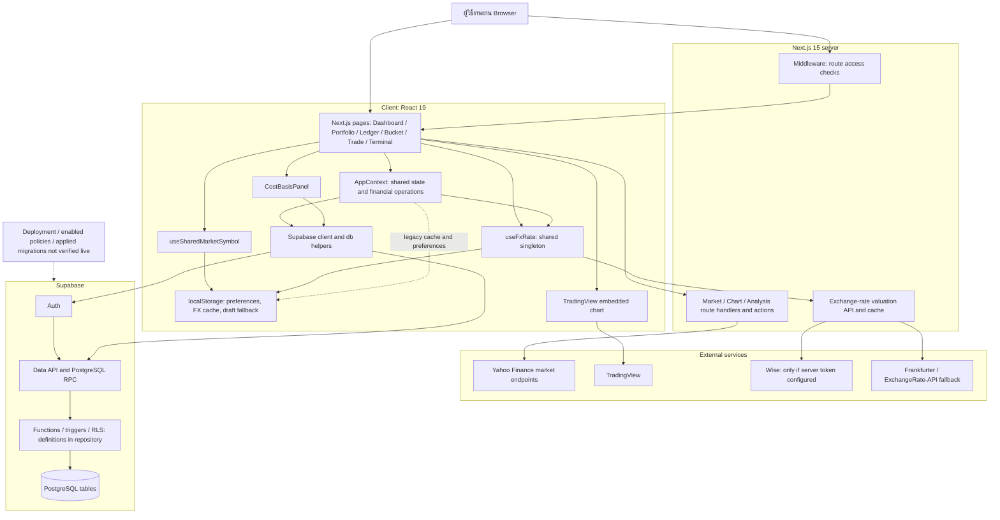
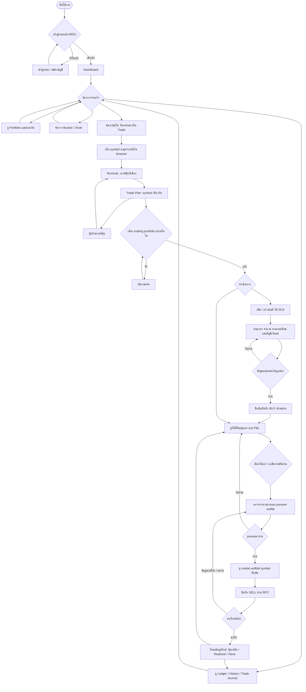
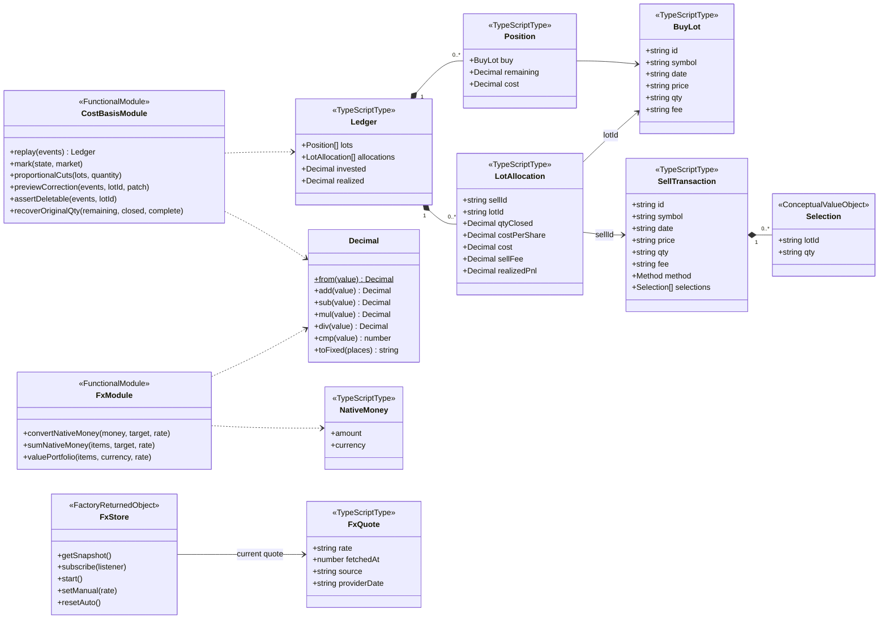
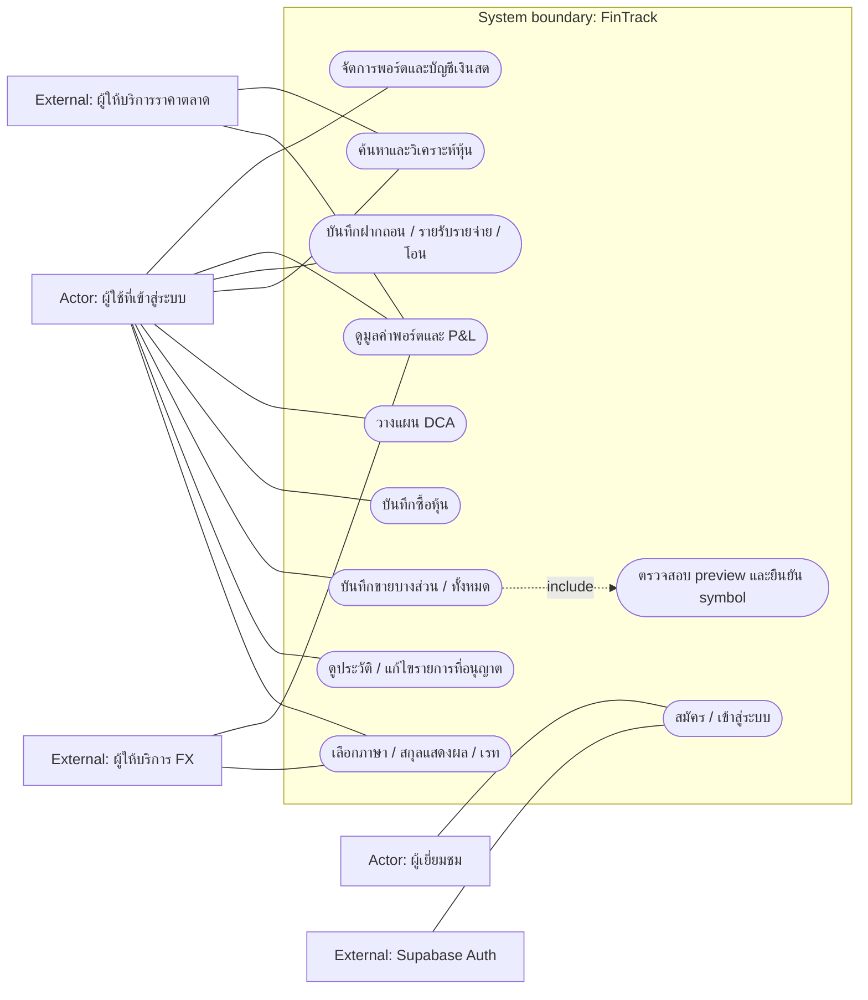
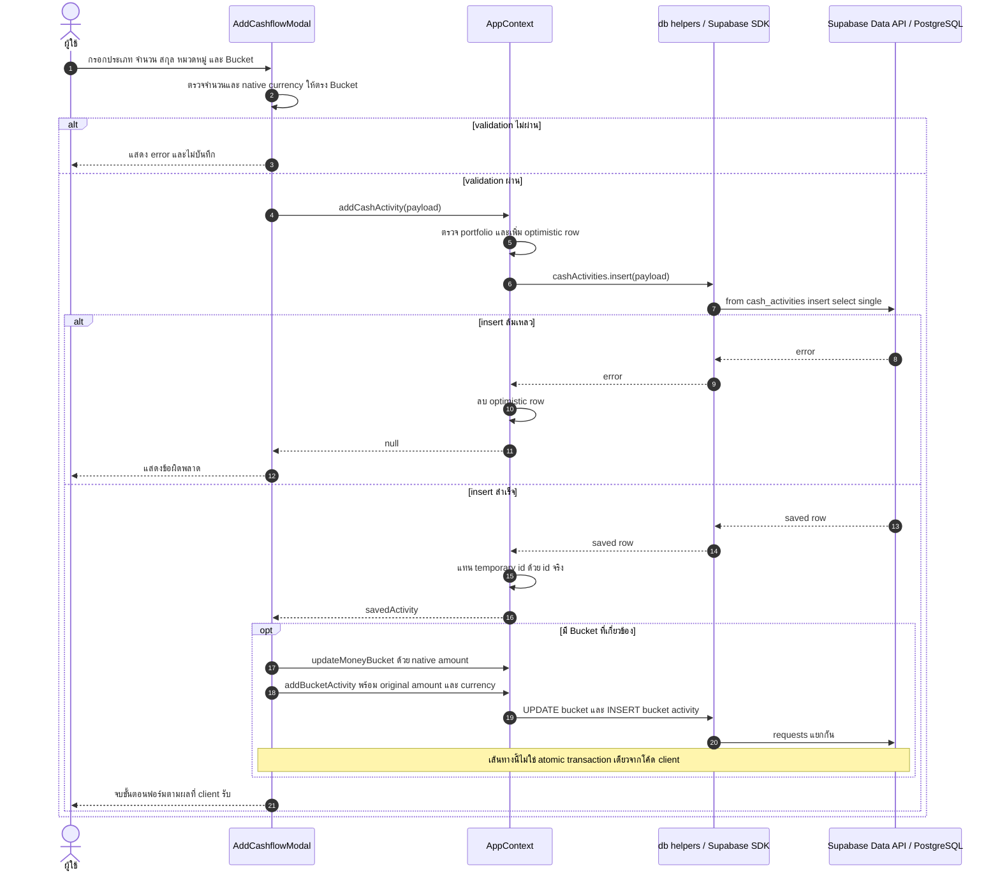

# ตัวอย่างไดอะแกรมฉบับแก้ตามโค้ด

ใช้แทนตัวอย่าง 6 หัวข้อที่แนบมา โดยคงขอบเขต as-is ของโค้ดที่ตรวจ ไม่ใช่ข้อเสนอให้เพิ่มฟังก์ชัน

รายละเอียดจุดแก้และการเทียบ PDF อยู่ใน [thesis-review.md](thesis-review.md)

## 1. System Architecture

## 2. User Flow

## 3. Class / Domain Model

## 4. ER Diagram

```mermaid
erDiagram
    auth_users {
        uuid id PK
    }
    profiles {
        uuid id PK, FK "required"
        text email "required"
        text full_name "nullable"
        text avatar_url "nullable"
        text language "nullable"
        text currency "nullable"
        boolean email_verified "nullable"
        text account_status "nullable"
        inet registration_ip "nullable"
        text device_fingerprint "nullable"
        text user_agent "nullable"
        timestamptz last_login_at "nullable"
        timestamptz created_at "nullable"
        timestamptz updated_at "nullable"
        text terminal_symbol "nullable"
        text terminal_interval "nullable"
    }
    assets {
        uuid id PK "required"
        uuid user_id FK "required"
        text name "required"
        text symbol "required"
        text asset_type "nullable"
        numeric value_usd "required"
        numeric quantity "nullable"
        numeric avg_purchase_price "nullable"
        numeric current_price "nullable"
        numeric change_24h "nullable"
        numeric change_percentage "nullable"
        numeric allocation_target "nullable"
        numeric allocation_current "nullable"
        text sector "nullable"
        text country "nullable"
        text notes "nullable"
        boolean is_active "nullable"
        timestamptz created_at "nullable"
        timestamptz updated_at "nullable"
        boolean is_favorite "nullable"
        integer sort_order "nullable"
        text allocation "nullable"
        uuid portfolio_id FK "nullable"
        uuid brokerage_account_id FK "nullable"
    }
    trades {
        uuid id PK "required"
        uuid user_id FK "required"
        uuid asset_id FK "nullable"
        text asset_name "required"
        text symbol "required"
        text type "required"
        numeric amount_usd "required"
        numeric quantity "required"
        numeric price_at_execution "required"
        text currency "nullable"
        numeric exchange_rate_at_time "nullable"
        numeric fees "nullable"
        numeric taxes "nullable"
        numeric total_cost "nullable"
        numeric profit_loss "nullable"
        numeric profit_loss_percentage "nullable"
        timestamptz execution_date "nullable"
        timestamptz settlement_date "nullable"
        text status "nullable"
        text notes "nullable"
        array tags "nullable"
        timestamptz created_at "nullable"
        timestamptz updated_at "nullable"
        numeric original_amount "nullable"
        uuid portfolio_id FK "nullable"
        uuid brokerage_account_id FK "nullable"
    }
    allocations {
        uuid id PK "required"
        uuid user_id FK "required"
        text label "required"
        numeric value "nullable"
        text color "nullable"
        timestamptz created_at "nullable"
        timestamptz updated_at "nullable"
        uuid portfolio_id FK "nullable"
    }
    money_buckets {
        uuid id PK "required"
        uuid user_id FK "required"
        text name "required"
        numeric target_percent "nullable"
        numeric current_amount "nullable"
        text color "nullable"
        text icon "nullable"
        boolean linked_to_expenses "nullable"
        timestamptz created_at "nullable"
        timestamptz updated_at "nullable"
        numeric target_amount "nullable"
        varchar currency "required"
        uuid portfolio_id FK "nullable"
    }
    bucket_activities {
        uuid id PK "required"
        uuid user_id FK "required"
        uuid bucket_id FK "nullable"
        text type "required"
        numeric amount "required"
        text note "nullable"
        timestamptz date "required"
        timestamptz created_at "nullable"
        varchar currency "nullable"
        numeric rate_at_time "nullable"
        numeric original_amount "nullable"
        uuid portfolio_id FK "nullable"
        uuid brokerage_entry_id FK "nullable"
    }
    cash_activities {
        uuid id PK "required"
        uuid user_id FK "required"
        text type "required"
        numeric amount "required"
        text category "required"
        text note "nullable"
        timestamptz date "required"
        timestamptz created_at "nullable"
        text time "nullable"
        uuid bucket_id FK "nullable"
        boolean is_transfer "nullable"
        varchar currency "nullable"
        numeric rate_at_time "nullable"
        numeric original_amount "nullable"
        uuid portfolio_id FK "nullable"
        uuid brokerage_entry_id FK "nullable"
        jsonb funding_details "nullable"
    }
    trade_journal {
        uuid id PK "required"
        uuid user_id FK "nullable"
        text symbol "required"
        text market "required"
        text timeframe "required"
        text status "nullable"
        jsonb entries "nullable"
        numeric stop_loss "nullable"
        jsonb take_profits "nullable"
        numeric avg_entry "nullable"
        numeric total_pnl "nullable"
        text notes "nullable"
        timestamptz opened_at "nullable"
        timestamptz closed_at "nullable"
        timestamptz created_at "nullable"
        jsonb signal_data "nullable"
        uuid portfolio_id FK "nullable"
    }
    dca_drafts {
        uuid id PK "required"
        uuid user_id FK "required"
        text symbol "required"
        jsonb entries "required"
        timestamptz updated_at "nullable"
        uuid portfolio_id FK "nullable"
    }
    portfolio_snapshots {
        uuid id PK "required"
        uuid user_id FK "required"
        numeric total_value "required"
        date date "required"
        timestamptz created_at "nullable"
    }
    user_categories {
        uuid id PK "required"
        uuid user_id FK "required"
        varchar type "required"
        varchar label "required"
        varchar icon "required"
        timestamptz created_at "required"
        uuid portfolio_id FK "nullable"
    }
    portfolios {
        uuid id PK "required"
        uuid user_id FK "required"
        text name "required"
        text color "required"
        boolean is_default "required"
        timestamptz created_at "required"
        timestamptz updated_at "required"
        text kind "required"
    }
    history_events {
        uuid id PK "required"
        uuid user_id FK "required"
        uuid portfolio_id "nullable"
        text source_table "required"
        uuid source_record_id "required"
        text action "required"
        text transaction_type "required"
        text asset_symbol "nullable"
        numeric quantity "nullable"
        numeric price "nullable"
        numeric gross_amount "required"
        numeric fees "required"
        numeric taxes "required"
        numeric net_amount "required"
        text currency "nullable"
        numeric exchange_rate "nullable"
        numeric realized_pnl "nullable"
        numeric unrealized_pnl "nullable"
        text category "nullable"
        uuid related_bucket_id "nullable"
        text note "nullable"
        timestamptz occurred_at "required"
        timestamptz recorded_at "required"
        jsonb metadata "required"
    }
    brokerage_accounts {
        uuid id PK "required"
        uuid user_id FK "required"
        uuid portfolio_id FK "required"
        text name "required"
        text broker "nullable"
        text currency "required"
        text color "required"
        timestamptz created_at "required"
        timestamptz updated_at "required"
        text kind "required"
    }
    brokerage_cash_entries {
        uuid id PK "required"
        uuid user_id FK "required"
        uuid portfolio_id FK "required"
        uuid brokerage_account_id FK "required"
        text type "required"
        numeric amount "required"
        text currency "required"
        uuid trade_id FK "nullable"
        timestamptz occurred_at "required"
        text note "nullable"
        timestamptz created_at "required"
    }
    cost_basis_methods {
        uuid user_id PK, FK "required"
        uuid portfolio_id PK, FK "required"
        text symbol PK "required"
        text method "required"
    }
    cost_basis_sales {
        uuid sell_id PK, FK "required"
        uuid user_id FK "required"
        text method "required"
        jsonb selections "required"
        jsonb request "required"
    }
    cost_basis_revisions {
        bigint id PK "required"
        uuid user_id FK "required"
        uuid portfolio_id FK "required"
        text symbol "required"
        text reason "required"
        jsonb snapshot "required"
        timestamptz created_at "required"
    }
    auth_users ||--o| profiles : "id"
    auth_users ||..o{ assets : "user_id"
    portfolios |o..o{ assets : "portfolio_id"
    brokerage_accounts |o..o{ assets : "brokerage_account_id"
    auth_users ||..o{ trades : "user_id"
    assets |o..o{ trades : "asset_id"
    portfolios |o..o{ trades : "portfolio_id"
    brokerage_accounts |o..o{ trades : "brokerage_account_id"
    auth_users ||..o{ allocations : "user_id"
    portfolios |o..o{ allocations : "portfolio_id"
    auth_users ||..o{ money_buckets : "user_id"
    portfolios |o..o{ money_buckets : "portfolio_id"
    auth_users ||..o{ bucket_activities : "user_id"
    money_buckets |o..o{ bucket_activities : "bucket_id"
    portfolios |o..o{ bucket_activities : "portfolio_id"
    brokerage_cash_entries |o..o{ bucket_activities : "brokerage_entry_id"
    auth_users ||..o{ cash_activities : "user_id"
    money_buckets |o..o{ cash_activities : "bucket_id"
    portfolios |o..o{ cash_activities : "portfolio_id"
    brokerage_cash_entries |o..o{ cash_activities : "brokerage_entry_id"
    auth_users |o..o{ trade_journal : "user_id"
    portfolios |o..o{ trade_journal : "portfolio_id"
    auth_users ||..o{ dca_drafts : "user_id"
    portfolios |o..o{ dca_drafts : "portfolio_id"
    auth_users ||..o{ portfolio_snapshots : "user_id"
    auth_users ||..o{ user_categories : "user_id"
    portfolios |o..o{ user_categories : "portfolio_id"
    auth_users ||..o{ portfolios : "user_id"
    auth_users ||..o{ history_events : "user_id"
    auth_users ||..o{ brokerage_accounts : "user_id"
    portfolios ||..o{ brokerage_accounts : "portfolio_id"
    auth_users ||..o{ brokerage_cash_entries : "user_id"
    portfolios ||..o{ brokerage_cash_entries : "portfolio_id"
    brokerage_accounts ||..o{ brokerage_cash_entries : "brokerage_account_id"
    trades |o..o{ brokerage_cash_entries : "trade_id"
    auth_users ||--o{ cost_basis_methods : "user_id"
    portfolios ||--o{ cost_basis_methods : "portfolio_id"
    auth_users ||..o{ cost_basis_sales : "user_id"
    trades ||--o| cost_basis_sales : "sell_id"
    portfolios ||..o{ cost_basis_revisions : "portfolio_id"
    auth_users ||..o{ cost_basis_revisions : "user_id"
```

## 5. Use Case

## 6. Sequence: เพิ่มรายรับ/รายจ่าย

## หมายเหตุการใช้ส่งรายงาน

- ER เป็น physical schema ตามไฟล์ผู้ใช้แนบ ไม่ได้ยืนยัน schema production
- Class เป็น domain types และ functional modules ตามโค้ด ไม่ใช่ ORM entities ที่สร้างขึ้นเอง
- Use Case ใช้ flowchart จำลองเพื่อ compatibility; ตรวจ rubric หากต้องใช้ strict UML
- Sequence เงินสดแสดง optimistic update และหลาย requests ตามโค้ด ไม่อ้างว่า atomic
- ไม่มีหลักฐาน GraphQL หรือ avatar storage implementation ในตัวอย่างที่ตรวจ จึงไม่นำมาวาดเป็น implemented subsystem
- ตาราง LotAllocation ไม่มีใน schema; ไม่เพิ่มเป็น entity ฐานข้อมูล
- ตรวจความอ่านง่ายของ ER หลัง render; ควรแบ่งภาพย่อยเมื่อนำลง A4

